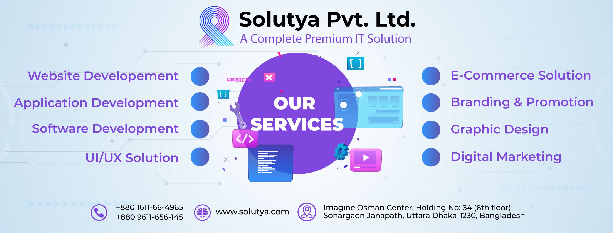

<!-- Solutya Banner -->

  

<h1 align="center">Solutya Pvt. Ltd.</h1>

<h3 align="center">Driving Business Growth Through Smart Technology 🚀</h3>

  Building digital experiences, intelligent software, and scalable technology solutions that help businesses grow.

  
  
  

---

## 👨‍💻 About Solutya

**Solutya Pvt. Ltd.** is a software development and digital solutions company based in Dhaka, Bangladesh.

We help businesses turn ideas into practical, reliable, and scalable digital products through modern technology and creative problem-solving.

Our focus is on building solutions that simplify operations, improve customer experiences, and support long-term business growth.

## 🚀 What We Do

<table>
  <tr>
    <td width="50%" valign="top">
      <h3>💻 Website Development</h3>
      Modern, responsive websites designed for performance, accessibility, and business growth.
    </td>
    <td width="50%" valign="top">
      <h3>📱 Application Development</h3>
      Web and mobile applications tailored to business requirements and customer needs.
    </td>
  </tr>
  <tr>
    <td width="50%" valign="top">
      <h3>⚙️ Software Development</h3>
      Custom software solutions designed for reliability, maintainability, and scalability.
    </td>
    <td width="50%" valign="top">
      <h3>🛍️ E-Commerce Solutions</h3>
      Digital commerce experiences that help businesses manage products, customers, and online sales.
    </td>
  </tr>
  <tr>
    <td width="50%" valign="top">
      <h3>🎨 UI/UX & Graphic Design</h3>
      User-friendly interfaces, creative visuals, and consistent digital brand experiences.
    </td>
    <td width="50%" valign="top">
      <h3>📈 Branding & Digital Marketing</h3>
      Branding, promotion, and digital marketing solutions to strengthen online visibility.
    </td>
  </tr>
</table>

## 💡 Our Digital Solutions

| Solution | Description |
|---|---|
| **SolHRM** | Human resource and workforce management |
| **SolFoody** | Digital solutions for food-related business operations |
| **WappSolutya** | WhatsApp marketing and business communication |

Explore our [website](https://solutya.com/) to learn more about our services and digital solutions.

## 🛠️ Technology & Engineering

We work with modern development tools and technologies to build maintainable, secure, and scalable applications.

  

### Our Engineering Principles

- **Scalable architecture** — building systems that evolve with business needs.
- **Clean code** — prioritizing readability, maintainability, and quality.
- **User experience** — creating intuitive and responsive digital products.
- **Security** — considering authentication, authorization, and data protection.
- **Continuous improvement** — learning, testing, and refining our solutions.

*The technologies shown represent our development focus and may vary by project.*

## 🌐 Explore Our GitHub

Explore our repositories, software projects, and technical work.

- 💻 [Browse repositories](https://github.com/Solutya?tab=repositories)
- 🌱 [Explore public projects](https://github.com/Solutya?tab=repositories&type=public)
- 🌐 [Visit Solutya](https://solutya.com/)

## 🤝 Work With Us

Have a project idea, a business challenge, or an opportunity to collaborate? We'd love to hear from you.

  
  
  

  📍 Dhaka, Bangladesh
   
  🌐 <a href="https://solutya.com/">solutya.com</a>
   
  📧 <a href="mailto:contact@solutya.com">contact@solutya.com</a>
   
  📞 +880 1329-65-9900

---

  <strong>From Ideas to Impact — Let's Build What's Next. 🚀</strong>
    
  © Solutya Pvt. Ltd. | Building meaningful digital solutions through technology.

