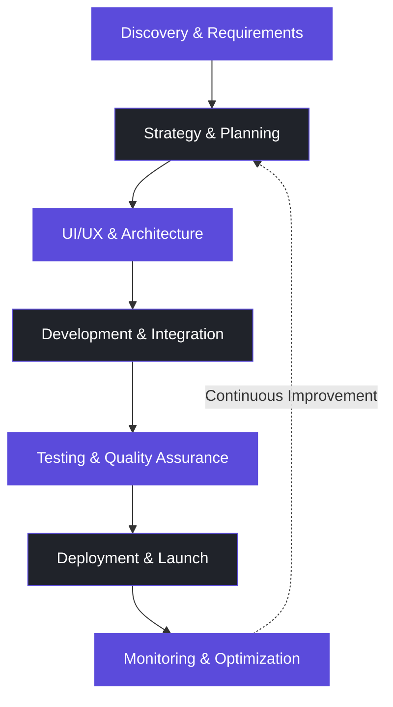

 <!-- ====================================================== -->
<!--                 SOLUTYA GITHUB PROFILE                -->
<!-- ====================================================== -->

  

<h1 align="center">SOLUTYA</h1>

<h3 align="center">Technology That Moves Business Forward.</h3>

  <strong>Software Engineering · Digital Innovation · Business Growth</strong>

  We design, develop, and deliver digital solutions that help businesses operate smarter, scale faster, and create lasting impact.

  
  
  
  

  
  
  
  

---

## 01. Who We Are

**Solutya Pvt. Ltd.** is a technology and digital solutions company based in Dhaka, Bangladesh, focused on helping businesses transform ideas into practical digital products.

We combine software engineering, product thinking, user experience, and digital growth strategies to create solutions aligned with real business objectives.

From custom software and web applications to e-commerce platforms, business management systems, and digital marketing, we help organizations build a stronger digital foundation.

Our approach is simple: understand the challenge, engineer the right solution, and build for sustainable growth.

  <strong>Think Strategically. Build Intelligently. Grow Continuously.</strong>

## 02. Our Core Capabilities

<table>
  <tr>
    <td width="50%" valign="top">
      <h3>💻 Web Development</h3>
      Responsive, high-performance websites and web platforms engineered for usability, maintainability, SEO, and business growth.
        
      Corporate Websites · Landing Pages · Next.js · WordPress
    </td>
    <td width="50%" valign="top">
      <h3>⚙️ Custom Software Engineering</h3>
      Business-focused software designed around operational workflows, integration requirements, security, and long-term scalability.
        
      Business Applications · SaaS · ERP · CRM
    </td>
  </tr>
  <tr>
    <td width="50%" valign="top">
      <h3>📱 Application Development</h3>
      Modern application experiences that connect users, services, and business processes across digital touchpoints.
        
      Web Applications · Mobile Solutions · APIs
    </td>
    <td width="50%" valign="top">
      <h3>🛍️ E-Commerce Solutions</h3>
      Digital commerce platforms that support product discovery, inventory management, orders, payments, and customer relationships.
        
      WooCommerce · Shopify · Custom Commerce
    </td>
  </tr>
  <tr>
    <td width="50%" valign="top">
      <h3>🎨 UI/UX & Product Design</h3>
      Intuitive interfaces and thoughtful user journeys that make complex products easier to understand and use.
        
      Product Design · Prototyping · Design Systems
    </td>
    <td width="50%" valign="top">
      <h3>📈 Digital Marketing & SEO</h3>
      Data-informed digital strategies to improve discoverability, attract relevant audiences, and support measurable business growth.
        
      Technical SEO · Google Ads · Meta Ads · Analytics
    </td>
  </tr>
  <tr>
    <td width="50%" valign="top">
      <h3>🤖 AI & Business Automation</h3>
      Exploring intelligent workflows and AI-assisted experiences that help businesses access information and reduce repetitive work.
        
      AI Integration · Knowledge Retrieval · Workflow Automation
    </td>
    <td width="50%" valign="top">
      <h3>🛡️ Quality & Technical Support</h3>
      Practical engineering support focused on reliability, performance, maintainability, and secure implementation.
        
      Testing · Optimization · Maintenance · Integrations
    </td>
  </tr>
</table>

## 03. Our Digital Product Ecosystem

We develop business-oriented digital products and platforms designed to simplify everyday operations and support digital transformation.

<table>
  <tr>
    <td width="33%" valign="top">
      <h3 align="center">SolHRM</h3>
      
👥

      
Human Resource Management

      
Workforce administration and HR workflows.

    </td>
    <td width="33%" valign="top">
      <h3 align="center">SolFoody</h3>
      
🍽️

      
Food Business Solutions

      
Digital tools for food-related business operations.

    </td>
    <td width="33%" valign="top">
      <h3 align="center">WappSolutya</h3>
      
💬

      
Business Communication

      
WhatsApp-based marketing and communication solutions.

    </td>
  </tr>
</table>

### Our Broader Product Vision

Our product ecosystem and ongoing development interests span multiple business functions:

- **SolCRM** — Customer relationship and sales management.
- **SolHRM** — Human resources and workforce management.
- **SolTMS** — Team and task management.
- **SolEMS** — Enterprise management workflows.
- **SOLPOS365** — Point-of-sale and retail operations.
- **SolSMS** — SMS and business messaging solutions.
- **SolSkillUp** — Learning and skills development.
- **SolONE** — A vision for integrated, AI-assisted SME digitalization.

Product availability, features, and development status may vary. Explore our [official website](https://solutya.com/) for current offerings.

## 04. Technology & Engineering Stack

We select technologies based on the requirements of each project, prioritizing maintainability, performance, security, and the ability to evolve as a business grows.

### Frontend Engineering

  

### Backend & Application Architecture

  

### Databases & Data Management

  

### Design, Collaboration & DevOps

  

Technology availability and project-specific implementation vary. Icons represent areas of our engineering toolkit, not a claim that every technology is used in every project.

## 05. How We Engineer Solutions

We believe great software is more than working code. It requires thoughtful architecture, clear communication, and consistent attention to quality.

| Principle | Our Approach |
|---|---|
| **Business Alignment** | Understand the problem before selecting the technology. |
| **Scalable Architecture** | Build systems that can adapt to changing requirements. |
| **Clean Code** | Prioritize readable, modular, and maintainable implementations. |
| **User-Centered Design** | Create intuitive experiences across devices and user journeys. |
| **Security by Design** | Apply appropriate authentication, authorization, and data protection practices. |
| **Performance Optimization** | Consider speed, efficiency, accessibility, and search visibility. |
| **Continuous Improvement** | Test, learn, refine, and improve throughout the product lifecycle. |

## 06. Our Development Workflow

Our process adapts to project scope, delivery priorities, technical constraints, and client feedback.

## 07. Open Source & Developer Collaboration

We value practical engineering, reusable knowledge, and opportunities to collaborate with the wider developer community.

Explore our public GitHub presence:

  
  

- Explore available repositories and project documentation.
- Follow our public development work.
- Share ideas, report issues, and discuss potential collaborations where repository contributions are supported.
- Connect with us for software engineering and digital product opportunities.

  

## 08. Industries & Business Use Cases

Our capabilities can support organizations across a range of industries and business models.

<table>
  <tr>
    <td width="50%" valign="top">
      <h3>🏢 Business & Enterprise</h3>
      Internal systems, dashboards, reporting, ERP, CRM, and workflow automation.
    </td>
    <td width="50%" valign="top">
      <h3>🛒 Retail & E-Commerce</h3>
      Online storefronts, product catalogs, inventory, POS, and order management.
    </td>
  </tr>
  <tr>
    <td width="50%" valign="top">
      <h3>🎓 Education & Training</h3>
      Learning platforms, course portals, student management, and digital experiences.
    </td>
    <td width="50%" valign="top">
      <h3>🏥 Healthcare & Services</h3>
      Service platforms, appointment workflows, operational systems, and customer-facing applications.
    </td>
  </tr>
  <tr>
    <td width="50%" valign="top">
      <h3>🏗️ Real Estate & Property</h3>
      Property websites, project showcases, inquiry management, and digital marketing.
    </td>
    <td width="50%" valign="top">
      <h3>🚀 Startups & SMEs</h3>
      MVP development, SaaS platforms, business automation, and scalable digital foundations.
    </td>
  </tr>
</table>

These are representative use cases for our capabilities, rather than a claim of completed projects in every industry.

## 09. Why Work With Solutya?

- **Integrated capabilities:** Software engineering, design, and digital marketing under one roof.
- **Business-first thinking:** Solutions shaped around real operational and commercial objectives.
- **Flexible technology choices:** Architectures selected to suit project requirements.
- **End-to-end collaboration:** Support across planning, development, launch, and improvement.
- **Growth-oriented delivery:** Digital foundations designed with future requirements in mind.

Our goal is to build useful technology that creates lasting value for the people and businesses using it.

## 10. Let's Build Something Meaningful

Have a product idea, a business challenge, or a technology project in mind?

Let's discuss how we can turn it into a practical digital solution.

  
  
  

  📍 Dhaka, Bangladesh
   
  🌐 <a href="https://solutya.com/">solutya.com</a>
   
  📧 <a href="mailto:contact@solutya.com">contact@solutya.com</a>
   
  📞 +880 1329-65-9900

---

  <strong>From Ideas to Impact. From Technology to Transformation.</strong>
    
  © Solutya Pvt. Ltd. — Building meaningful digital solutions through technology.
   
  Software Engineering · Digital Innovation · Business Growth

